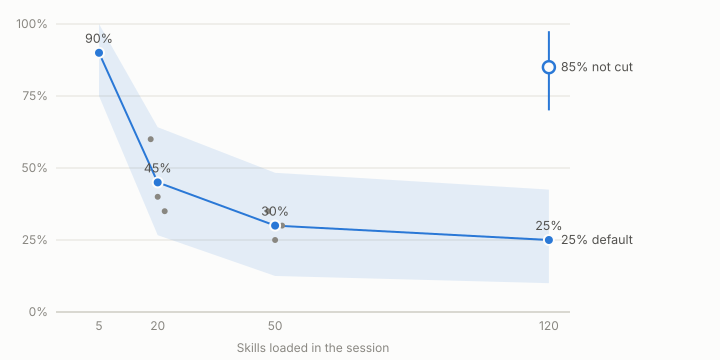
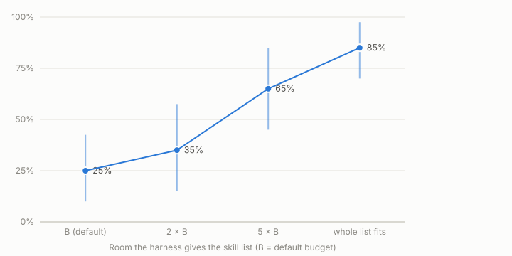
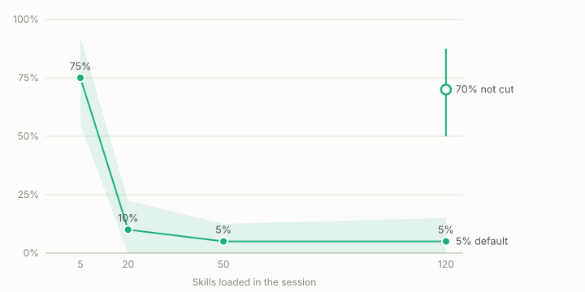
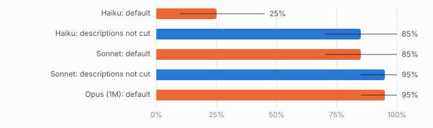

# Testing whether an agent picks the right skill as skills pile up

> **Method only.** Names and numbers are illustrative, not real results.

[Original HTML](<Skill%20Selection%20Test%20Methodology%20(sanitized).html>) — download this file and open it in a browser for interactive chart tooltips.

## The test

1. **Requests with a known answer:** ~20 user-style requests per topic area. None names a skill; each has one expected skill.
2. **Skill sets of growing size:** the skills under test plus random others (5, 20, 50, 120).
3. **One fresh, isolated run per request:** stop at the agent's first move and record the skill it called. Two runs per request.
4. **Score:** right skill, no skill, or wrong skill.

**Isolation:** don't use a bare mode that drops the skill tool; use an empty config dir and an empty working dir instead, keep built-in skills, and pin the model and harness version.

**Ranges:** 95% bootstrap over requests (not repeats), so compare large gaps, not single points.

## 1. Random mixes

**Every mix drops, by different amounts**
Gray dots: individual random mixes. Hollow marker: largest set with nothing cut.

Which other skills are installed matters, so test more than one install profile.

## 2. Budget sweep

**Accuracy rises with the room the skill list gets**
Same largest set; only the budget changes.

A step-by-step rise means description truncation is a cause, not just "too many choices".

## 3. Second topic area, written blind

**A second area drops too**
Requests written from the skill descriptions only, before any results.

Also check where misses go: some land on the harness's own built-in skills. A blind second labeling of the expected answers guards against biased labels.

## 4. Real install, per model

**Same install, different models**
Orange: default. Blue: descriptions not cut.

The list budget depends on the model, so the same install can fit one model and be cut hard on another. Report per model, and log list size vs. budget per run.
